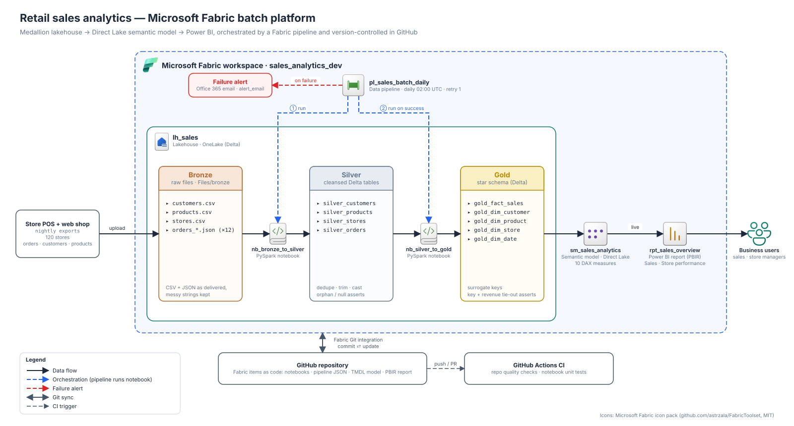

# architecture-diagrams — an agent skill

Teach your AI coding agent to draw **professional architecture diagrams with real vendor icons**: AWS, Azure,
Google Cloud, Kubernetes, Microsoft Fabric / Power BI, and 3,000+ SaaS and open-source logos. Every diagram
comes out as an **editable draw.io file** plus an **SVG or PNG** ready for your README, docs or slides.



Most agents produce diagrams with guessed icon names, overlapping labels and spaghetti arrows. This skill
fixes that with four things:

- **Real icons, never guessed.** It looks every icon up in a catalog, and an icon that doesn't exist fails
  loudly. The catalogs include 952 AWS, 363 GCP and 78 Kubernetes icons, 1,746 draw.io SVGs (all Azure, IBM and
  SAP icons among them), the Microsoft Fabric pack and Simple Icons brand logos.
- **A planned layout.** One straight main flow, with control above and operations below, nested boundaries and
  an 8 px grid. It follows written design rules, not an auto-layout guess.
- **Automatic layout checks.** The checks catch overlaps, lines cutting through captions, labels on borders,
  crossing lines, cramped arrowheads and text that doesn't fit.
- **Render and look.** The agent renders a PNG and reviews it before handing the diagram over.

| AWS (native draw.io stencils) | Azure (embedded SVG icons) |
|---|---|
|  |  |

## Install

### Claude Code

```bash
claude plugin marketplace add manaf-dev/architect-diagrams
claude plugin install architecture-diagrams@manaf-dev-skills
```

Inside a Claude Code session, use `/plugin marketplace add manaf-dev/architect-diagrams`, then
`/plugin install architecture-diagrams@manaf-dev-skills`. Claude Code v2.1.275 and later can do it in one step:
`/plugin install architecture-diagrams --marketplace manaf-dev/architect-diagrams`.

To update, run `claude plugin marketplace update manaf-dev-skills` and then
`claude plugin update architecture-diagrams@manaf-dev-skills`.

### Codex, Cursor, GitHub Copilot, Gemini CLI, OpenCode, Windsurf and others

```bash
npx skills add manaf-dev/architect-diagrams          # choose agents interactively
npx skills add manaf-dev/architect-diagrams -g       # install for all your projects
npx skills add manaf-dev/architect-diagrams -a codex # target one agent
```

### claude.ai / Claude desktop

Go to **Customize → Plugins → Add → Add marketplace** and enter `manaf-dev/architect-diagrams`. The skill's
guidance works there too. Its scripts need an agent that can run Python, such as Claude Code or the agents above.

### Manual

Copy `skills/architecture-diagrams/` into your agent's skills folder, for example `~/.claude/skills/` for
Claude Code or `~/.agents/skills/` for Codex.

## Use

Ask in plain words. The skill triggers on architecture-diagram requests:

> "Draw the architecture of this repo for the README, with real Azure icons."
>
> "Make a reference architecture: API Gateway → Lambda → DynamoDB, EventBridge fan-out to SQS and Step Functions."
>
> "Diagram our Fabric medallion pipeline: notebooks, pipeline, Direct Lake semantic model, Power BI report."

In Claude Code you can also call it directly with `/architecture-diagrams:architecture-diagrams`.

The agent then:
1. models your system, reading your IaC or code when it's available;
2. resolves every icon;
3. plans the grid and writes a short layout spec;
4. builds and lints the diagram;
5. renders it and looks at it;
6. delivers `name.drawio` plus `name.svg` or `name.png`, keeping the spec so later edits are easy.

The scripts also work by hand:

```bash
python skills/architecture-diagrams/scripts/icons.py search "api gateway" --set aws4
python skills/architecture-diagrams/scripts/archdiagram.py my-arch.yaml --out-dir docs/architecture
python skills/architecture-diagrams/scripts/render.py docs/architecture/my-arch.svg preview.png
```

## Requirements

- **Python 3.10+.** Add PyYAML (`pip install pyyaml`) for YAML specs; JSON specs need nothing extra.
- **Edge, Chrome or Chromium** for PNG previews.
- **For native AWS and Kubernetes stencils:** draw.io Desktop (offline), or internet access so draw.io's
  viewer script can render them.

## Licence and credits

The skill and its code are MIT-licensed. The icons and icon catalogs belong to their owners and keep their own
terms: AWS, Microsoft, Google, the Kubernetes authors, draw.io (Apache-2.0), Simple Icons (CC0) and the
[Microsoft Fabric icon pack](https://github.com/astrzala/FabricToolset) (MIT). See
[THIRD_PARTY_NOTICES.md](THIRD_PARTY_NOTICES.md). Vendor icons may be used to depict those vendors' services
in architecture diagrams. Don't modify them or imply endorsement.
