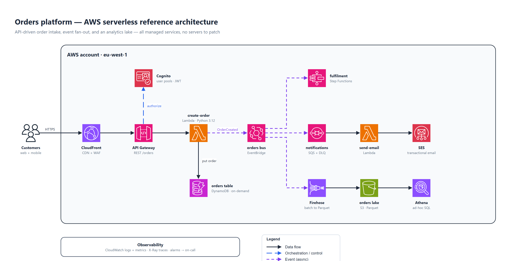
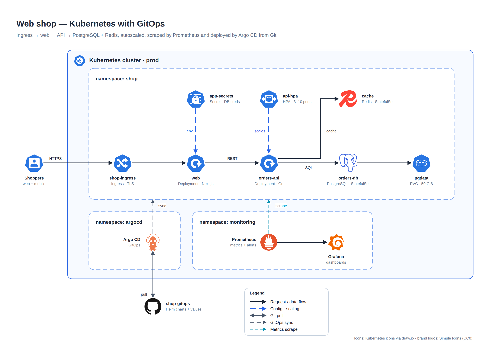
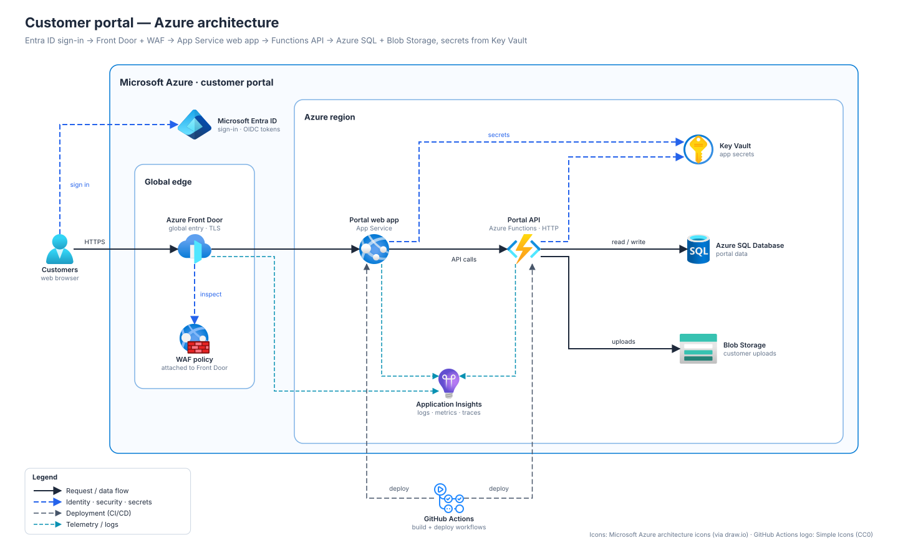

# Architecture Diagrams

**An agent skill that makes your coding agent draw architecture diagrams you'd actually put in a README.**

Ask in plain words and get a clean diagram with real AWS, Azure, Google Cloud, Kubernetes, Microsoft Fabric
and SaaS icons. You get an editable **draw.io** file plus an **SVG or PNG** ready for docs and slides.

Works with Claude Code, Codex, Cursor, GitHub Copilot, Gemini CLI, OpenCode, Windsurf and other agents
that support skills.



## Why

Ask an agent for an architecture diagram without this skill and you usually get guessed icon names, labels
on top of each other and arrows going everywhere. This skill gives it a method:

- **Real icons, never guessed.** Every icon is looked up in a catalog, and a missing icon fails loudly
  instead of turning into a blank box. 952 AWS, 363 GCP and 78 Kubernetes icons, all of Azure, IBM and SAP,
  the Microsoft Fabric pack and 3,000+ brand logos.
- **A planned layout.** One clear main flow, control above, operations below, nested boundaries, all on
  an 8 px grid. The agent follows written design rules instead of hoping an auto-layout works out.
- **Automatic checks.** Overlaps, lines through captions, labels on borders, crossing lines, cramped
  arrowheads and text that doesn't fit are all caught before you see the diagram.
- **The agent looks at it.** It renders a PNG and reviews it before handing the diagram over.

## Quick start

**Claude Code**

```bash
claude plugin marketplace add manaf-dev/architect-diagrams
claude plugin install architecture-diagrams@manaf-dev-skills
```

**Codex, Cursor, Copilot, Gemini CLI, OpenCode, Windsurf and others**

```bash
npx skills add manaf-dev/architect-diagrams
```

Claude Code installs for all your projects by default; `npx skills` installs into the current project by
default. See [Install for one project only](#install-for-one-project-only) to change that.

Then ask:

> "Draw the architecture of this repo for the README, with real Azure icons."

### Install for one project only

**Claude Code:** run both commands from the project folder with a scope:

```bash
claude plugin marketplace add manaf-dev/architect-diagrams --scope project
claude plugin install architecture-diagrams@manaf-dev-skills --scope project
```

`--scope project` writes to `.claude/settings.json`; commit it and teammates who open the repo in Claude Code
are offered the skill too. Use `--scope local` instead to keep it to yourself; that writes to
`.claude/settings.local.json`, which stays out of git.

**Other agents:** `npx skills add manaf-dev/architect-diagrams` already installs into the current project.
Add `-g` only if you want it everywhere.

**Manual:** copy `skills/architecture-diagrams/` into the project's own skills folder, such as
`.claude/skills/` for Claude Code or `.agents/skills/` for Codex.

<details>
<summary>More install options</summary>

**Inside a Claude Code session:** `/plugin marketplace add manaf-dev/architect-diagrams`, then
`/plugin install architecture-diagrams@manaf-dev-skills`. Claude Code v2.1.275 and later can do both in one
step: `/plugin install architecture-diagrams --marketplace manaf-dev/architect-diagrams`.

**Update in Claude Code:** `claude plugin marketplace update manaf-dev-skills`, then
`claude plugin update architecture-diagrams@manaf-dev-skills`.

**`npx skills` options:** add `-g` to install for all your projects, or `-a codex` to target one agent.

**claude.ai / Claude desktop:** go to **Customize → Plugins → Add → Add marketplace** and enter
`manaf-dev/architect-diagrams`. The design guidance works there, but the scripts need an agent that can run
Python, such as Claude Code.

**Manual, for all projects:** copy `skills/architecture-diagrams/` into your agent's user skills folder,
for example `~/.claude/skills/` for Claude Code or `~/.agents/skills/` for Codex.

</details>

## Gallery

| Kubernetes with GitOps (native stencils + brand logos) | Azure web app (embedded SVG icons) |
|---|---|
|  |  |

The specs behind every gallery image are in
[`skills/architecture-diagrams/examples/`](skills/architecture-diagrams/examples/).

## What to ask for

The skill triggers on any architecture-diagram request. Some examples:

> "Make a reference architecture: API Gateway → Lambda → DynamoDB, with EventBridge fan-out to SQS and Step Functions."
>
> "Diagram our data platform: Fabric notebooks, a pipeline, a Direct Lake semantic model and a Power BI report."
>
> "Read the Terraform in `infra/` and draw what it deploys."

In Claude Code you can also call it directly with `/architecture-diagrams:architecture-diagrams`.

## How it works

1. **Model the system.** Components, boundaries and flows, read from your IaC or code when it's there.
2. **Resolve every icon** from the bundled catalogs.
3. **Plan the grid** and write a short YAML layout spec.
4. **Build and lint** the diagram.
5. **Render and look** at a PNG, then fix what's off.
6. **Deliver** `name.drawio` plus `name.svg` or `name.png`. The spec is kept, so later edits are quick.

You can run the scripts yourself too:

```bash
python skills/architecture-diagrams/scripts/icons.py search "api gateway" --set aws4
python skills/architecture-diagrams/scripts/archdiagram.py my-arch.yaml --out-dir docs/architecture
python skills/architecture-diagrams/scripts/render.py docs/architecture/my-arch.svg preview.png
```

## Requirements

- **Python 3.10+.** YAML specs need PyYAML (`pip install pyyaml`); JSON specs need nothing extra.
- **Chrome, Edge or Chromium** for PNG previews.
- **Internet access while building.** Icons are downloaded the first time they're used, then cached.
  Finished files have the icons embedded, except native AWS and Kubernetes stencils (next point).
- **Native AWS and Kubernetes stencils** also need draw.io Desktop or internet access, so draw.io's viewer
  can render them.

## Licence and credits

The skill and its code are [MIT-licensed](LICENSE). Icons and icon catalogs belong to their owners and keep
their own terms: AWS, Microsoft, Google, the Kubernetes authors, draw.io (Apache-2.0), Simple Icons (CC0)
and the [Microsoft Fabric icon pack](https://github.com/astrzala/FabricToolset) (MIT). See
[THIRD_PARTY_NOTICES.md](THIRD_PARTY_NOTICES.md). Vendor icons may be used to show those vendors' services
in architecture diagrams. Don't modify them or imply endorsement.
